# Entity Relationship Diagram

```mermaid
erDiagram
    USERS ||--o{ ORDERS : places
    USERS ||--o| CARTS : owns
    USERS ||--o{ COUPON_USAGES : redeems
    USERS ||--o{ ACTIVITY_LOGS : performs
    USERS }o--o{ ROLES : model_has_roles
    ROLES }o--o{ PERMISSIONS : role_has_permissions

    CATEGORIES ||--o{ CATEGORIES : parent_of
    CATEGORIES ||--o{ PRODUCTS : contains
    PRODUCTS ||--o{ PRODUCT_IMAGES : has
    PRODUCTS ||--o{ CART_ITEMS : added_as
    PRODUCTS ||--o{ ORDER_ITEMS : snapshotted_as

    CARTS ||--o{ CART_ITEMS : contains
    COUPONS ||--o{ CARTS : applied_to
    COUPONS ||--o{ ORDERS : applied_to
    COUPONS ||--o{ COUPON_USAGES : counted_by

    ORDERS ||--o{ ORDER_ITEMS : has
    ORDERS ||--o{ ORDER_STATUS_HISTORIES : records
    ORDERS ||--o{ PAYMENTS : paid_by
    ORDERS ||--o{ COUPON_USAGES : consumes

    USERS {
        bigint id PK
        string name
        string email UK
        string password
        string type "customer|staff"
        bool is_active
        string phone
        timestamp email_verified_at
        timestamp last_login_at
    }

    ROLES {
        bigint id PK
        string name
        string guard_name "web"
    }

    PERMISSIONS {
        bigint id PK
        string name
        string guard_name "web"
    }

    CATEGORIES {
        bigint id PK
        bigint parent_id FK
        string name
        string slug UK
        bool is_active
        int sort_order
        timestamp deleted_at
    }

    PRODUCTS {
        bigint id PK
        bigint category_id FK
        string name
        string slug UK
        string sku UK
        bigint price "cents"
        bigint discount_price "cents, nullable"
        int stock
        bool is_active
        timestamp deleted_at
    }

    PRODUCT_IMAGES {
        bigint id PK
        bigint product_id FK
        string path
        bool is_primary
        int sort_order
    }

    CARTS {
        bigint id PK
        bigint user_id FK "nullable, unique"
        uuid cart_token UK "nullable"
        bigint coupon_id FK "nullable"
    }

    CART_ITEMS {
        bigint id PK
        bigint cart_id FK
        bigint product_id FK
        int quantity
        bigint unit_price "cents at add time"
    }

    COUPONS {
        bigint id PK
        string code UK
        string type "percentage|fixed"
        bigint value "percent or cents"
        bigint min_order_amount
        bigint max_discount_amount
        int usage_limit
        int per_user_limit
        int used_count
        timestamp starts_at
        timestamp expires_at
        bool is_active
        timestamp deleted_at
    }

    COUPON_USAGES {
        bigint id PK
        bigint coupon_id FK
        bigint user_id FK
        bigint order_id FK
    }

    ORDERS {
        bigint id PK
        string order_number UK
        bigint user_id FK
        string status "pending|paid|processing|shipped|delivered|cancelled"
        bigint subtotal
        bigint discount_total
        bigint shipping_total
        bigint tax_total
        bigint grand_total
        string coupon_code "snapshot"
        string shipping_line1
        string shipping_city
        string shipping_country
        timestamp paid_at
        timestamp cancelled_at
    }

    ORDER_ITEMS {
        bigint id PK
        bigint order_id FK
        bigint product_id FK "nullable"
        string product_name "snapshot"
        string product_sku "snapshot"
        bigint unit_price "snapshot"
        int quantity
        bigint line_total
        string product_image "snapshot"
    }

    ORDER_STATUS_HISTORIES {
        bigint id PK
        bigint order_id FK
        string from_status
        string to_status
        bigint changed_by FK "nullable"
        string note
    }

    PAYMENTS {
        bigint id PK
        bigint order_id FK
        string provider_payment_intent_id UK
        string provider_refund_id
        bigint amount
        string currency
        string status
        timestamp paid_at
        timestamp refunded_at
    }

    STRIPE_WEBHOOK_EVENTS {
        bigint id PK
        string stripe_event_id UK
        string type
        json payload
        timestamp processed_at
    }

    ORDER_NUMBER_SEQUENCES {
        bigint id PK
        int year UK
        int sequence
    }

    SETTINGS {
        bigint id PK
        string key UK
        text value
        string type
        string group
    }

    ACTIVITY_LOGS {
        bigint id PK
        bigint user_id FK "nullable"
        string action
        string subject_type
        bigint subject_id
        json properties
    }
```

## Notes

- **Money** is always integer cents (`unsignedBigInteger`). Currency is USD.
- **Soft deletes** on `categories`, `products`, `coupons`. Orders/payments are never deleted; they are an audit trail.
- **No separate addresses table.** The shipping address is a denormalised snapshot on `orders`, protected by the order policy. This keeps checkout immutable (an edited saved address can never rewrite a placed order) and satisfies SEC-5 for addresses by construction. Recorded in `DECISIONS.md`.
- **No variants table** (fixed decision D6). A product row is the sellable unit.
- The order number is generated from `order_number_sequences` inside a transaction in P6 (`ORD-YYYY-NNNNNN`).
- `stripe_webhook_events.stripe_event_id` is unique, which provides database-level webhook idempotency.
